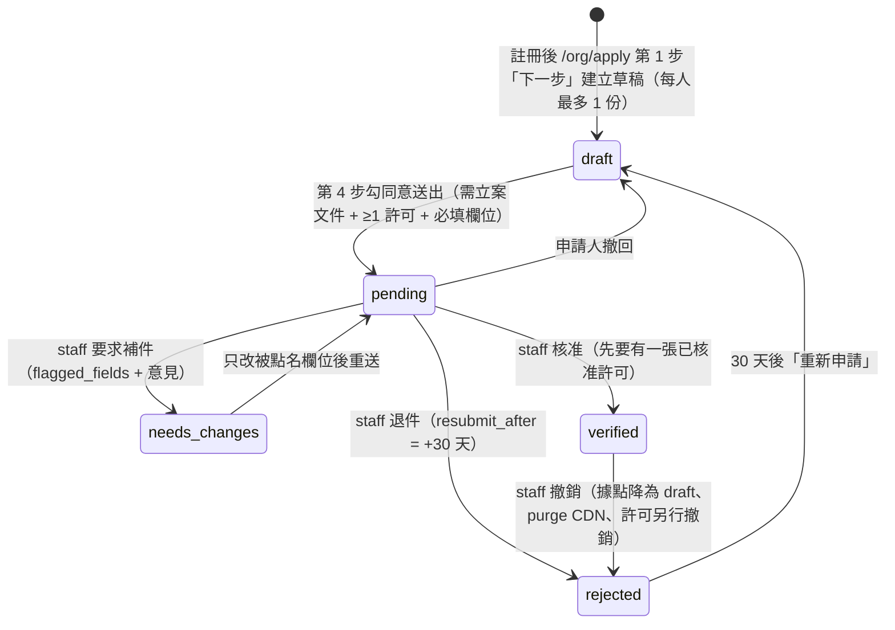
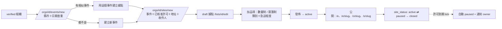

# 03 公益／慈善組織流程模擬（2026-10-29）

扮演 Wishly 上的公益組織（社福基金會、救災協會）：承辦人註冊帳號、申請成為公益組織、補件、通過後管理成員、建立救災事件與據點、收實收、遇到許可到期／被撤銷時的處境。全部以真實瀏覽器（Playwright / Chromium）點擊 Web（:3000），後端為本機完整 API（:8080，`ORGS_ENABLED` 開）。

- 腳本：`apps/web/qa/role-flows/org.mjs`（主流程，62 步）、`apps/web/qa/role-flows/org-tick.mjs`（許可到期背景工作，需等 API 下一次整點 tick）
- 原始結果：`apps/web/qa/out/role-flows/org.json`（每步狀態、觀察、HTTP/console 問題）、`org-tick.json`、截圖 `apps/web/qa/out/role-flows/org/<步驟 ID>.png`（不進 git）
- 相關規格：`docs/superpowers/specs/2026-10-27-org-relief-registration-design.md`、`docs/superpowers/plans/2026-10-27-org-relief-phase1.md`、CLAUDE.md「公益組織與救災據點（0041）」

## 1. 角色設定（persona）

| Persona | 帳號 | 在組織中的角色 | 目標 |
|---|---|---|---|
| **陳承辦（承辦人）** | UI 註冊的新 email（OTP 取自 Mailpit） | `owner` | 15 分鐘內把申請送出；被要求補件時知道改什麼；通過後建立事件、據點、品項並上線；管理成員 |
| **林協調（協調人）** | 已有帳號（API 預先建立，模擬「已是 Wishly 用戶」） | `coordinator` | 收到邀請信後加入；建立／編輯事件與據點、加品項、發布；不能管成員 |
| **小王（志工）** | 邀請時**尚未註冊**的 email（驗證「對方還沒有帳號」的路徑） | `volunteer` | 在手機上到據點點收物資、登記實收；看不到也動不了管理功能 |
| **愛心捐助者（外部）** | 另一個一般帳號 | 非成員 | 在公開據點頁認捐物資、用點數眾籌；組織被撤銷時的處境 |
| 路人／訪客 | 不同帳號／未登入 | 非成員 | 驗證權限邊界 |
| 申請人 B（輔助） | 另一個一般帳號 | 自己的申請 | 撞統編、被退件、30 天後重新申請 |
| **審核者（staff）** | API 建帳號後以 SQL 設 `is_staff`（平台外動作） | 平台 staff | 只用於推進組織流程：核准／補件／退件／撤銷許可／下架事件。營運面完整測試見 `04-operator.md` |

平台外動作（腳本都在步驟 note 註明）：從 Mailpit 取 OTP 與信件、以 `is_staff` SQL 建審核者、以 SQL 快轉時間（`resubmit_after`、許可 `valid_to`）、staff 發點數給捐助者（`POST /admin/wallets/grants`）、無 UI 的操作改走 API（新增許可、編輯事件、刪除帳號）。

## 2. 流程總覽

### 2.1 組織申請與審核狀態機（`organizations.verification_status`）

### 2.2 事件與據點

### 2.3 角色權限矩陣（預期，執行時逐項驗證）

| 動作 | owner | coordinator | volunteer | 非成員 | 未登入 |
|---|---|---|---|---|---|
| 看組織後台、據點、實收 | ✓ | ✓ | ✓ | 404 | 導登入 |
| 登記實收 | ✓ | ✓ | ✓ | 404 | — |
| 建事件、建據點、加品項、改據點狀態 | ✓ | ✓ | 403 | 404 | — |
| 成員／邀請／角色／停用 | ✓ | 403（可看成員清單） | 403 | 404 | — |
| 送審／撤回／改申請資料／新增許可 | ✓ | 403 | 403 | 404 | — |

## 3. 步驟設計（ID、操作、預期結果）

標示 `【staff】` 的步驟由審核者操作，其餘都是組織端。

### A. 入口與註冊

| ID | 操作 | 預期結果 |
|---|---|---|
| O-01 | 訪客開 `/org` | SSR 200；標題、4 個賣點、申請前準備 3 項、CTA「申請成為公益組織」 |
| O-02 | 登入頁找入口 | 有「公益組織？從這裡申請」連到 `/org` |
| O-03 | 未登入點 CTA | 導向 `/login?redirect=/org/apply` |
| O-04 | 登入頁 →「建立帳號」→ UI 註冊（OTP 由 Mailpit 取） | 註冊完成後回到 `/org/apply`（redirect 沒掉） |

### B. 申請表（4 步）

| ID | 操作 | 預期結果 |
|---|---|---|
| O-05 | 第 1 步空白、輸入錯誤統編 | 「下一步」鎖住；統編檢查碼錯誤即時提示；只能輸入數字 8 碼 |
| O-06 | 填基本資料（財團法人、統編、立案字號、主管機關、官網、簡介）→ 下一步 | 建立草稿；`/me.orgs` 出現 draft + owner |
| O-07 | 第 2 步填負責人與聯絡窗口（blur 自動保存） | DB 即時保存；聯絡手機以密文存放 |
| O-08 | 沒有上傳文件就走到第 4 步送審 | 被擋、跳回第 3 步、訊息說明缺立案文件 |
| O-09 | 上傳 `.txt`、10.5MB PDF、內容是純文字的偽 `.pdf`、正常 PDF | 前兩者被擋並說明；偽 PDF 理想上被擋；正常 PDF 成功 |
| O-10 | 新增勸募許可（字號＋起迄＋許可函）；再試迄日早於起日 | 正常的列入清單（pending）；顛倒日期被擋且停在原步驟 |
| O-11 | 重新整理；再 `POST /orgs` | 草稿從正確步驟還原；第二份草稿 409 `ORG_DRAFT_EXISTS` |
| O-12 | 第 4 步預覽、未勾同意、勾選送出 | 預覽資料完整；未勾時鎖住；送出後「審核中」 |
| O-13 | 審核中：改資料、撤回、再送審 | 審核中不可改（409）；撤回回 draft 可編輯；可再送審 |
| O-14 | 審核中嘗試建事件／據點 | 被擋並說明尚未通過審核（規格 §5.1 說審核期間可先建草稿清單，觀察是否一致） |
| O-15 | 申請人 B 用相同統編申請 | 至少在送審被擋並提示聯絡平台；換統編後可送審 |

### C. 審核往返（staff 推進）

| ID | 操作 | 預期結果 |
|---|---|---|
| O-16 | 【staff】/admin/orgs 看待審、檢視、下載立案文件 | 看得到資料；文件經短效網址下載 |
| O-17 | 【staff】許可未核准就核准組織 | 被擋（需 ≥1 張已核准許可） |
| O-18 | 【staff】要求補件：勾 legal_name、registration_no、documents，寫意見 | 狀態 needs_changes；未勾欄位送不出 |
| O-19 | 承辦人看補件通知 | 狀態頁顯示意見；只有被點名欄位可編輯；收到補件信（含意見與連結） |
| O-20 | 補件：改欄位、刪舊文件換新文件、重送 | 回 pending；flagged_fields 清空 |
| O-21 | 【staff】核准許可 → 核准組織 | verified |
| O-22 | 承辦人看到「已通過審核」→「切換到組織身分」 | 進入 `/orgs/[id]`；收到核准信 |
| O-23 | 申請人 B：staff 退件 → B 看原因與 30 天倒數 → 快轉 → 重新申請 | 顯示未通過、原因、可重申日期；30 天內重申 409；快轉後回 draft |

### D. 組織頁

| ID | 操作 | 預期結果 |
|---|---|---|
| O-24 | 開 `/orgs/[id]`、看身分選單 | 「組織模式」標記、空狀態、owner 才有成員入口、選單能切個人/組織 |
| O-25 | 訪客開 `/o/[slug]` | 已驗證徽章、公開聯絡資訊、不含審核用手機；不存在 slug 404 |
| O-26 | 通過後想改簡介／新增第二張許可 | 觀察有無 UI；API 行為（改簡介被擋？新增許可可？） |

### E. 成員管理

| ID | 操作 | 預期結果 |
|---|---|---|
| O-27 | 開 `/orgs/[id]/members` | 只有自己（擁有者）、邀請表單（email、角色、顯示代號） |
| O-28 | 邀請已有帳號的協調員 | 產生連結與 QR、列入待接受、收到邀請信 |
| O-29 | 協調員點信中連結 | 未登入先導登入再回邀請頁；接受後進組織；看不到成員管理入口；連結只能用一次 |
| O-30 | 邀請尚未註冊的志工 | 觀察是否寄信；轉交連結後志工註冊→回邀請頁→接受 |
| O-31 | 其他帳號開邀請連結 | 提示「請用 x@… 登入，或請管理者改寄」 |
| O-32 | 取消邀請 | 待接受清單消失；已取消連結開啟時顯示錯誤、不可接受 |
| O-33 | 志工→協調員→志工 | 即時改權限；寫 audit |
| O-34 | 停用成員 → 對方失去存取 → 重新啟用 | 確認視窗；被停用者 API 404、頁面「找不到」；啟用後恢復 |
| O-35 | 最後一位 owner 嘗試自我降級 | 409「至少需要一位擁有者」；自己沒有停用鈕；升協調員為 owner 後才能降原 owner |
| O-36 | 最後一位 owner 離開（刪帳號，拋棄式組織） | 最早加入的協調員升 owner |

### F. 事件與據點

| ID | 操作 | 預期結果 |
|---|---|---|
| O-37 | 承辦人建立事件（花蓮縣＋日期，查重無結果） | 顯示表單、建立成功、列在後台 |
| O-38 | 協調員在 ±7 天內同縣市建立 | 出現「是不是這個？」；選「用這個事件建立據點」預選事件；+9 天不提示 |
| O-39 | 「都不是，建立新事件」；編輯事件 | 可建立；事件編輯 UI？非成員改事件被拒 |
| O-40 | 建據點（事件＋許可＋地址＋收件人＋電話） | 進入清單編輯頁；draft；是否有座標／地圖 |
| O-41 | 加數量制品項（飲水、急缺、20）；未選類別 | 成功；未選類別擋住 |
| O-42 | 加眾籌制品項（目標 1500 點） | 成功；注意必填欄位與提示 |
| O-43 | 發佈 | active；發佈前公開頁 404 |
| O-44 | 公開曝光：/e、/e/slug、/o/slug、/s/slug | 事件頁含據點與急缺彙總；據點頁有已驗證徽章與地址，不洩漏收件人電話 |
| O-45 | /explore | 不列救災據點；有連到 /e 的橫幅 |

### G. 外部捐助者

| ID | 操作 | 預期結果 |
|---|---|---|
| O-46 | 未登入按「登入後來送」 | 導登入，帶回據點的 redirect |
| O-47 | 登入後認捐 3 箱 | claims reserved、保留 48 小時 |
| O-48 | 眾籌貢獻 600 點（staff 先發點） | contribution pledged、進度更新 |
| O-49 | 組織端看認捐／眾籌進度、有無通知與感謝管道 | 看得到在途數量與進度；觀察缺漏 |

### H. 實收

| ID | 操作 | 預期結果 |
|---|---|---|
| O-50 | 志工在 `/orgs/[id]/sites/[wid]/receipts` 登記 5 箱 | 累計、經手人與時間 |
| O-51 | 實收邊界：0／負數／超大、同 Idempotency-Key、超過需求 | 前三者 422；同 key 重放不重複；觀察是否限制超收、可否更正 |
| O-52 | 志工越權：UI 連結、管理 API、直接開編輯頁 | UI 隱藏；API 403/404；編輯頁不應讓志工操作 |

### I. 營運狀態與撤銷

| ID | 操作 | 預期結果 |
|---|---|---|
| O-53 | 暫停據點 → 公開頁／/e → 恢復 | 公開頁顯示暫停且不可認捐（API 409 `SITE_PAUSED`）；/e 不列；恢復後恢復 |
| O-54 | 結束據點（closed）→ 實收鎖定；能否回 active | 實收鈕 disabled、API 409 `SITE_CLOSED` |
| O-55 | 許可到期（SQL 快轉 `valid_to`）：到期當下據點狀態、「恢復營運」重驗、背景 tick | 恢復被擋；tick 另由 `org-tick.mjs` 等整點驗證 |
| O-56 | 【staff】撤銷已核准許可 | 使用該許可的上線據點被暫停；組織端看到什麼、誰被通知 |
| O-57 | 【staff】隱藏事件 | 公開頁消失；組織端看到什麼；能否在該事件建據點 |
| O-58 | 權限矩陣：路人、協調員越權、未登入、一般用戶開 admin | 皆被拒（404/403/401）；UI 導登入或顯示找不到 |
| O-59 | 手機 390 寬逐頁體檢（/org、後台、成員、事件／據點表單、實收、編輯頁、公開頁、邀請頁、申請表） | 無水平捲動；觸控目標 ≥ 40px |
| O-60 | 志工在手機上登記實收（觸控） | 可完成；按鈕 ≥ 44px |
| O-61 | 【staff】撤銷整個組織（二次確認） | 據點降 draft、公開頁消失；組織端看到什麼、誰被通知 |
| O-62 | 通知信彙整 | 各角色收到的信 |

## 4. 執行結果

**共 62 步**：✅ pass 47　⚠️ gap 15　❌ fail 0　⛔ blocked 0。（gap＝流程能走通，但發現設計缺口、規格與實作不一致或體驗問題；原因見每步與第 5 節。）

執行與環境註記：

- 執行：`cd apps/web && node qa/role-flows/org.mjs`（約 5 分鐘）。腳本在開發過程中為修選擇器與等待時序跑過多次（每次都用全新的唯一 email／組織名稱，沒有刪改任何既有資料）；表中是最後一次完整執行的結果，原始資料在 `apps/web/qa/out/role-flows/org.json`，截圖在 `apps/web/qa/out/role-flows/org/<步驟 ID>.png`（手機頁面為 `O-59-m-*.png`）。
- 每次 UI 註冊前，`lib.mjs` 的 `resetOtpLimits()` 會清掉 `rate_limits` 裡 `otp_` 開頭的 key（四個 agent 共用同一 IP，OTP 限流會累積；真實使用者不會遇到）。
- 事件日期：腳本在啟動時以 SQL 挑一個「花蓮縣前後 12 天內沒有任何事件」的歷史日期，避免查重提示被其他 agent 或先前執行的事件干擾。
- 平台外動作（腳本已在各步 note 註明）：從 Mailpit 取 OTP／邀請信／通知信；以 `is_staff` SQL 建審核者；以 SQL 快轉 `resubmit_after` 與許可 `valid_to`；staff 以 API 發點數給捐助者；無 UI 的操作（新增許可、編輯事件、`DELETE /me`、為節省時間而鋪設的第二、三個據點）走 API。
- 檔案上傳用腳本產生的小 PDF／PNG（`qa/out/role-flows/org-files/`）。附帶一個 Playwright 小發現：`setInputFiles` 對含中文檔名的路徑在本沙盒不會觸發 change 事件，改用 ASCII 檔名（不是產品問題）。
- 審核者 staff 帳號只用於推進流程；營運面完整測試見 `04-operator.md`。

### 4.1 逐步結果

| ID | 狀態 | 步驟 | 觀察 | 截圖 |
|---|---|---|---|---|
| O-01 | ✅ | 訪客讀 /org 介紹頁（說明、申請前準備、CTA） | h1=「救災物資，直接送到需要的地方」；頁面宣稱「可開捐款收據」；實際捐款收據（donation_receipts）第一段未實作，見問題清單 | `org/O-01.png` |
| O-02 | ✅ | 登入頁有「公益組織？從這裡申請」入口 |  | `org/O-02.png` |
| O-03 | ✅ | 未登入點 CTA → 導向登入且帶 redirect=/org/apply | url=http://localhost:3000/login?redirect=/org/apply | `org/O-03.png` |
| O-04 | ✅ | 承辦人由登入頁 →「建立帳號」→ UI 註冊（OTP 由 Mailpit 取）→ 回到 /org/apply | register url=http://localhost:3000/register?redirect=/org/apply；註冊後 url=http://localhost:3000/org/apply（OTP 取自 Mailpit：平台外動作） | `org/O-04.png` |
| O-05 | ✅ | 申請表第 1 步：必填未填時「下一步」鎖住；統編檢查碼錯誤即時提示 | maxlength=8、inputmode=numeric；輸入 1234abc 後值=1234abc | `org/O-05.png` |
| O-06 | ✅ | 第 1 步填寫（組織類型、統編、立案字號、主管機關、簡介）→ 下一步建立草稿 | 草稿 org=01a18894-98a5-7859-95ee-13bf2240a7dc status=draft role=owner | `org/O-06.png` |
| O-07 | ✅ | 第 2 步：負責人與聯絡（欄位 blur 自動保存），上一步/下一步 | DB 已保存：陳大文\|林小美\|pr-f26993a3@example.org；聯絡手機以密文存放=t | `org/O-07.png` |
| O-08 | ✅ | 未上傳任何文件就走到第 4 步送審 → 應被擋回第 3 步並說明缺什麼 | 錯誤訊息：「請至少上傳一份立案文件」 | `org/O-08.png` |
| O-09 | ⚠️ | 上傳檢核：.txt 被擋、11MB 被擋、內容不是 PDF 的 .pdf 檔、正常立案證書 | txt 後 alert=僅接受 PDF、JPG、PNG problems=console: Failed to load resource: the server responded with a status of 401 (Unauthorized);console: Failed to load resource: the server responded with a status of 422 (Unprocessable Entity)；txt → 「僅接受 PDF、JPG、PNG」；10.5MB → 「檔案超過 10MB」（前端檢查）；內容是純文字的偽 .pdf：被接受（沒有檢查檔案內容）；DB 立案文件數=1；【缺口】偽 PDF（純文字、副檔名 .pdf）被接受：前端只看 file.type（由副檔名推得），後端未驗魔術字節 | `org/O-09.png` |
| O-10 | ⚠️ | 新增勸募許可（字號、有效期間起迄、許可函檔案） | 清單出現 勸募字第f26993a3號；許可狀態=pending；迄日早於起日：DB 筆數=0；畫面訊息=「截止日不可早於起始日」；仍停在第 3 步=false；許可文件數=1（失敗時前端會刪除孤兒文件）；【缺口】許可日期驗證失敗（pointer=/valid_to）時，申請表被導回第 1 步（apply.vue:34 ptrStep 對未知 pointer 預設 1），使用者在第 3 步按「新增許可」卻被丟到「基本資料」，錯誤訊息還留在頁面頂端 | `org/O-10.png` |
| O-11 | ✅ | 重新整理後草稿從正確步驟還原；每人最多 1 份草稿（再 POST /orgs → 409） | 重整後直接回到第 4 步（stepOf 判斷資料齊全）；再 POST /orgs → 409 ORG_DRAFT_EXISTS | `org/O-11.png` |
| O-12 | ✅ | 第 4 步預覽資料 → 未勾同意時送出鎖住 → 勾選送出 → 進入「審核中」 | 狀態=pending | `org/O-12.png` |
| O-13 | ✅ | 審核中：表單唯讀、可撤回（回草稿可編輯）、再送審 | 審核中 PATCH 簡介 → 409 ORG_NOT_EDITABLE；撤回後 DB 狀態=draft | `org/O-13.png` |
| O-14 | ⚠️ | 審核中（未通過）嘗試建立事件／據點 → 被擋並說明 | 事件：「貴組織尚未通過審核，通過後才能建立事件與據點」；據點 API（審核中）→ 409 PERMIT_INVALID；【缺口】規格 §5.1 寫「審核期間可以先建立草稿清單」，但建事件需 verified、建據點需事件與已核准許可，審核中實際無法預備草稿（設計與實作不一致） | `org/O-14.png` |
| O-15 | ⚠️ | 另一位申請人 B 用相同統編：第 1 步不擋、送審才被擋（提示聯絡平台）→ 換統編後送審 | 用與審核中組織相同的統編建立草稿：第 1 步「下一步」成功（統編唯一性只在送審時檢查，partial unique index 不含 draft）；（API）B 補齊聯絡人／文件／許可：平台外替身動作；送審撞統編：欄位提示=「此統一編號已有申請中或已通過的組織」；頁首訊息=「此統一編號已有申請中或已通過的組織」；被導回第 1 步=true；換統編後 B 送審成功（pending）；【缺口】統編重複要等到第 4 步送出才被偵測（第 1 步即時只檢查格式與檢查碼）；B 已填完四步、上傳文件才知道撞統編。建議第 1 步 blur 時呼叫檢查端點，或至少在草稿建立時提示 | `org/O-15.png` |
| O-16 | ✅ | 【staff】在 /admin/orgs 看到待審申請、檢視資料並下載立案文件 | 下載檔名=registration-01a18894-ae35-784f-a0fa-f0ad8f9acc7c.pdf（文件由私有儲存經短效網址取回）；手機欄位在 staff 畫面：顯示明文（審核用） | `org/O-16.png` |
| O-17 | ✅ | 【staff】許可尚未核准就核准組織 → 被擋 | 錯誤：「需至少一張已核准的勸募許可」 | `org/O-17.png` |
| O-18 | ✅ | 【staff】要求補件：勾選 legal_name 與 documents、寫意見 | 未勾欄位送出：請至少勾選一個欄位；DB 狀態=needs_changes flagged={legal_name,registration_no,documents} | `org/O-18.png` |
| O-19 | ✅ | 承辦人看到「需補件」與意見；只有被點名欄位可改，其餘鎖定；是否收到通知信 | 畫面：需補件：請修改被點名的欄位後重新送出 / 立案證書影本不清楚，請重新上傳；全名請與證書一致，並補正立案字號。；欄位 disabled：{"組織全名":false,"對外顯示名稱":true,"立案字號":false,"主管機關":true,"組織簡介":true}；補件通知信：「【Wishly】組織「QA 慈心基金會 f26993a3」需要補件或修正」 內文=你的組織「QA 慈心基金會 f26993a3」需要補件或修正。 審核備註：立案證書影本不清楚，請重新上傳；全名請與證書一致，並補正立案字號。 組織申請頁面：http://localhost:3000/org/apply ；信中含審核意見=true；含申請頁連結=true；含被點名欄位=true | `org/O-19.png` |
| O-20 | ✅ | 補件：改全名與立案字號、換立案證書（含刪除舊檔）→ 重新送審 | 補件時刪除舊文件鈕 disabled=false；刪除舊立案文件：1 → 0；立案文件數=1；重送後 flagged_fields={}；review_note=立案證書影本不清楚，請重新上傳；全名請與證書一致，並補正立案字號。 | `org/O-20.png` |
| O-21 | ✅ | 【staff】核准勸募許可 → 核准組織 | DB 狀態=verified | `org/O-21.png` |
| O-22 | ✅ | 承辦人狀態頁顯示「已通過審核」→ 按「切換到組織身分」進 /orgs/[id]；核准通知信 | 核准通知信：「【Wishly】組織「QA 慈心基金會 f26993a3」已通過審核」 內文=你的組織「QA 慈心基金會 f26993a3」已通過審核。 審核備註：- 組織申請頁面：http://localhost:3000/org/apply ；含連結=true | `org/O-22.png` |
| O-23 | ✅ | 【申請人 B】staff 退件 → B 看到未通過、原因與 30 天倒數 → 快轉後重新申請 | B 畫面：撞統編協會 f26993a3 / / 未通過審核 / / 立案字號查無資料，退件。 / / 2026-11-28 之後（30 天後）可重新申請；30 天內直接 PATCH 重新申請（API）→ 409 RESUBMIT_TOO_EARLY；（SQL）把 resubmit_after 快轉到過去：時間快轉屬平台外動作；重新申請後狀態=draft；review_note=立案字號查無資料，退件。；舊文件數=2 | `org/O-23.png` |
| O-24 | ✅ | 組織後台 /orgs/[id]：組織模式標記、身分選單、空狀態、owner 才有「成員與邀請」 | h1=QA 慈心基金會 f26993a3；身分選單：["個人","QA 慈心基金會 f26993a3","登出"]；slug=EECSrUR5sZ | `org/O-24.png` |
| O-25 | ✅ | 公開組織頁 /o/[slug]（尚無據點）：已驗證徽章、聯絡資訊、SSR 狀態 | ORG / VERIFIED / QA 慈心基金會 f26993a3已驗證組織 / QA 測試用（撤回後修改）：平時做偏鄉兒童營養，災時支援物資集散。 / 官方網站 ・ pr-f26993a3@example.org ・ 02-12345678 / 收件據點 / 目前沒有收件中的據點。；og:title=QA 慈心基金會 f26993a3；不存在 slug HTTP 404 | `org/O-25.png` |
| O-26 | ⚠️ | verified 後：編輯組織資料／新增第二張許可有無 UI 入口；API 行為 | 已通過狀態頁 input 數=0（無許可/資料編輯入口）；verified 後 PATCH 簡介 → 409 ORG_NOT_EDITABLE；新增第二張許可（API）→ 201；【缺口】組織通過後無任何 UI 可新增許可或修改簡介/聯絡資訊/Logo（/orgs/[id] 只有事件、據點、成員）；據點表單的 stNoPermit 文案指示「到組織資料補件」，但該頁不存在 | `org/O-26.png` |
| O-27 | ✅ | 成員頁初始狀態：只有自己（擁有者）；邀請表單欄位 | 成員：["陳承辦f26\n擁有者\n協調員\n志工"]；邀請角色選項：擁有者/協調員/志工；預設=volunteer | `org/O-27.png` |
| O-28 | ✅ | 邀請 coordinator（對方已有帳號）：產生連結／QR、列入待接受、收到邀請信 | 連結：http://localhost:3000/org/invite/<token>；信件主旨：「【Wishly】邀請你加入「QA 慈心基金會 f26993a3」」；內含連結=true | `org/O-28.png` |
| O-29 | ✅ | 協調員從信件連結開啟 /org/invite/[token]：未登入→導登入→接受→進組織；看不到「成員與邀請」 | 未登入 → http://localhost:3000/login?redirect=/org/invite/zu4yZ4qqv-lMdOKXg6fOLv6eTPOCkheAc7-fYVlX2zQ；邀請頁：WISHLY / 繁體中文 / English / Tiếng Việt / Bahasa Indonesia / ☀ / 協 / 協調員林f26 / ▾ / WISHLY / ORG / 加入組織 / 我的清單 / 好友 / 點數 / 設定 / / QA 慈心基金會 f26993a3 邀請你擔任「協調員」 / / 接受邀請；同一連結再接受一次 → 410 INVITE_EXPIRED | `org/O-29.png` |
| O-30 | ⚠️ | 邀請尚未註冊的志工 email：有無寄信？轉交連結後志工註冊→接受 | 邀請寄給尚未註冊的 flow-orgvol-f26993a3@example.com：收到信件數=0；畫面提示：邀請連結已建立，請複製或掃描 QR 分享；註冊後 url=http://localhost:3000/org/invite/wB2ywIMOoPPYtf7ScvIBZmsLGnLUczByWjDaEyG-fxg；【缺口】對尚未註冊的 email 不寄邀請信（org_members.rs:177 只通知既有使用者），owner 必須自行複製連結轉交；規格 §5.2「透過 notify outbox 寄信」與申請頁「對方還沒有帳號時可以先註冊再加入」的情境無信可收 | `org/O-30.png` |
| O-31 | ✅ | 邀請 email 不符：另一個帳號開連結 → 提示用哪個 email 登入 | （API）建立另一封邀請以測試 email 不符；錯誤：「請用 someone-f26993a3@example.com 登入，或請管理者改寄到你的 email」 | `org/O-31.png` |
| O-32 | ✅ | 取消邀請：待接受清單消失；已取消連結再開 → 錯誤 | 取消後 invites 紀錄：[{"e":"someone-","c":true,"a":false},{"e":"flow-org","c":false,"a":true},{"e":"flow-org","c":false,"a":true}]；開已取消邀請：「邀請已過期或已取消」 | `org/O-32.png` |
| O-33 | ✅ | 角色變更：志工→協調員→志工（owner 於成員列表下拉）；被改者權限即時改變 | 升級後 DB 角色=coordinator；audit_logs org.member.update 筆數=2 | `org/O-33.png` |
| O-34 | ✅ | 停用成員（確認視窗）→ 對方立即失去存取；重新啟用 | 被停用者 GET sites → 404；被停用者開 /orgs/id 畫面：WISHLY / 繁體中文 / English / Tiếng Việt / Bahasa Indonesia / ☀ / 志 / 志工小王f26 / ▾ / WISHLY / ORGS / 組織後台 / 我的清單 / 好友 / 點數 / 設定 / 找不到這個項目，可能已被刪除或你沒有權限；沒有「移除成員」：只有停用（資料保留）；移除/離開組織無 UI | `org/O-34.png` |
| O-35 | ✅ | 最後一位 owner 保護：自己降級被擋、自己沒有停用鈕；升協調員為 owner 後才能降原 owner | 自己降級：「組織至少需要一位有效的擁有者」；原 owner 降級後 DB 角色=coordinator；降級後原承辦人的「成員與邀請」入口：； link 數=0；（API，以新 owner 身分）還原原承辦人為 owner → 200；協調員降回 coordinator；提醒：頁面上看到 /me 角色可能在重新整理前仍是舊值；owner 轉移無「轉讓擁有者」單一動作 | `org/O-35.png` |
| O-36 | ⚠️ | 最後一位 owner 離開（刪除帳號）：據點移交、最早加入的協調員升 owner；沒有人可接則關閉（以拋棄式組織驗證） | DELETE /me → 200 {"anonymized_at":"2026-10-29T16:54:40.614327Z","deleted":true}；刪除後成員：01a18895-c63f-7e82-b39c-3e1f757ce0cf:owner:true \| 01a18895-c8ed-7495-a52d-6939b14e2cab:owner:false；【缺口】「離開組織」沒有任何 UI；唯一路徑是刪除整個帳號（且帳號刪除本身也沒有 UI，只有 DELETE /me）。想離開組織的協調員/志工只能請 owner 停用 | — |
| O-37 | ✅ | 承辦人建立救災事件：選縣市＋日期 → 查重無結果 → 填表建立 | 日期 2025-05-09（隨機歷史日期以避免撞到其他 agent 的事件）；查重無結果→直接顯示表單；事件 id=01a18896-470c-7a06-bbac-67f59b2faf28 slug=7OXQCJ7keK counties={花蓮縣} | `org/O-37.png` |
| O-38 | ✅ | 協調員查重：同縣市日期±7 天 → 出現「是不是這個？」→ 選「用這個事件建立據點」帶 event 參數 | 提示內容：是不是這個？ / / 已有相近的事件，請先確認，避免重複建立 / / QA 花蓮地震 f26993a3 / 2025-05-09 · 花蓮縣 / 用這個事件建立據點 / 都不是，建立新事件；導向 http://localhost:3000/orgs/01a18894-98a5-7859-95ee-13bf2240a7dc/sites/new?event=<eventId>；+9 天不提示相似：true | `org/O-38.png` |
| O-39 | ⚠️ | 「都不是，建立新事件」路徑（協調員另建第二個事件，供後續下架測試） | 第二事件 slug=3J7pkwdMFQ；事件編輯（API，UI 無入口）→ 200；非成員改事件 → 403 ORG_ROLE_REQUIRED；【缺口】事件「編輯」沒有 UI（事件列表只是純文字，沒有編輯／檢視連結；PATCH /relief-events/{id} 僅 API 可用）；建立後發現名稱打錯只能請工程處理 | `org/O-39.png` |
| O-40 | ✅ | 建立據點：選事件與許可、地址／收件人／電話／保留時數 → 進清單編輯頁 | 可選許可：["請選擇許可","勸募字第f26993a3號 · 2026-09-30 - 2027-04-28","勸募二號f26993a3 · 2026-10-20 - 2026-12-29"]；據點 id=01a18896-6dec-71c0-8226-2815c1393ebf slug=gSGipjFwYI status=draft/active/public；據點座標欄位數（wishlists 表）=0：據點只有文字地址，沒有座標或地圖（規格 §2.1 寫「帶 PostGIS 座標、地址」） | `org/O-40.png` |
| O-41 | ✅ | 品項（數量制）：飲水 急缺 20 箱 | item id=01a18896-733f-7e79-a112-412139c71f1d；未選類別/急迫程度：select required 擋住=true | `org/O-41.png` |
| O-42 | ⚠️ | 品項（眾籌制）：醫療 高 睡袋 目標 1500 點，需先有收件資訊 | 未填募集截止：「請填寫截止時間，或先設定清單的活動日期」（標籤寫「選填」，但救災據點沒有活動日 → 實際必填）；眾籌 item id=01a18896-812f-756c-9f96-680f5601888e mode=crowdfund/1500；【缺口】眾籌品項的「募集截止」標示（選填），但救災據點沒有活動日，後端要求必填（錯誤訊息「請填寫截止時間，或先設定清單的活動日期」對 relief 據點沒有「活動日」可設，訊息誤導）；且眾籌需要在據點層級提供預設截止日 | `org/O-42.png` |
| O-43 | ✅ | 據點上線：按「發佈並分享」→ 取得分享連結；草稿期公開頁 404 | 發佈前 /s/slug HTTP 404；分享連結=http://localhost:3000/s/gSGipjFwYI | `org/O-43.png` |
| O-44 | ✅ | 公開曝光：/e 列表、/e/[slug]（據點、缺口彙總）、/o/[slug]（據點出現）、/s/[slug]（徽章、地址、不顯示捐助者） | /e/slug：RELIEF / EVENT / QA 花蓮地震 f26993a3 / 地震・受災縣市：花蓮縣（花蓮市、吉安鄉）・發生日期：2025-05-09 / QA 測試事件 / SITE 01 / QA 花蓮物資站 f26993a3 / QA 慈心基金會 f26993a3已驗證組織 / 花蓮縣花蓮市中山路 100 號（QA 集散站） / 急缺 1高 1；/s/slug：WISHLIST / OPEN / QA 花蓮物資站 f26993a3 / QA 慈心基金會 f26993a3已驗證組織・所屬事件：QA 花蓮地震 f26993a3 / 收件地址：花蓮縣花蓮市中山路 100 號（QA 集散站） / 0 / % / 完成度 0%・0 / 2 項 / ITEMS / 02 / DONE / 00 / OPEN / 02 / 送禮或贊助需要登入會員。登入 / 圖 / No.01 / 0% / 瓶裝水 600ml（箱）飲水急缺 / 已認領 0 / 20 / 登入後來送 / 圖 / No.02 / 0% / 保暖睡袋住宿與帳篷高募集中 / 已募 0 / 1,500 點・還差 1,500 點 / 募集至 202；收件電話是否公開顯… | `org/O-44.png` |
| O-45 | ✅ | 探索頁 /explore 不列救災據點、頂端有連到 /e 的橫幅 | HTTP 200 url=http://localhost:3000/explore；橫幅：有 | `org/O-45.png` |
| O-46 | ✅ | 外部捐助者（未登入）在據點頁按「我來送」→ 要求登入（D50） | 未登入時品項上的動作：「登入後來送」（元素=a）；url=http://localhost:3000/login?redirect=/s/gSGipjFwYI | `org/O-46.png` |
| O-47 | ✅ | 外部捐助者登入後認捐 3 箱（數量制） | claims：3:reserved；保留期限（預設 48h）：2 days；捐助者頁面訊息： | `org/O-47.png` |
| O-48 | ✅ | 眾籌品項：捐助者貢獻點數（點數由 staff 發放：平台外動作）→ 進度條 | （API）staff 發點 → 201 ；眾籌對話按鈕：["100","500","1,000","剩餘全額 1,500","確認贊助 600 點","取消"]；contributions：600:pledged；pledged=600 | `org/O-48.png` |
| O-49 | ⚠️ | 組織端看到認捐／眾籌進度：誰認捐、數量、保留期限；有無感謝／通知 | 編輯頁品項區：‹ / WISHLY / 組織模式：QA 慈心基金會 f26993a3 / 繁體中文 / English / Tiếng Việt / Bahasa Indonesia / ☀ / 進行中 / 進度 / 陳 / 陳承辦f26 / ▾ / WISHLY / LISTS / QA 花蓮物資站 f26993a3 / 我的清單 / 好友 / 點數 / 設定 / 01 / 無圖 / 瓶裝水 600ml（箱） / 需要 20・直接送禮・優先度中 / 飲水 · 急缺 · 已實收 0 / ↑ / ↓ / 編輯 / 登記實收 / 刪除 / 02 / 無圖 / 保暖睡袋 / 心願眾籌 600 / 1,500 點・至 2026/11/29 23:59・優先度中 / 住宿與帳篷 · 高 · 已實收 0 / ↑ / ↓ / 編輯 / 登記實收 / 刪除 / ＋ 新增品項 / 據點 / 收件地址 / 花蓮縣花蓮市中山路 100 號（QA 集散站） / 據點；品項區是否顯示「已認領」數量（在途 3 箱）=false；顯示已實收=true；組織看得到捐助者名稱=false；與此據點相關的通知：claim.purchase_reminder→p… | `org/O-49.png` |
| O-50 | ✅ | 志工登記實收：/orgs/[id]/sites/[wid]/receipts → 登記 5 箱（備註）→ 累計與經手人 | 登記前：瓶裝水 600ml（箱） / 飲水・急缺 / 需求 20 累計實收 0 / 登記實收；登記後：瓶裝水 600ml（箱） / 飲水・急缺 / 需求 20 累計實收 5 / 登記實收；對話內歷史：登記實收 / / 瓶裝水 600ml（箱） 累計實收 5 / / +5 第一車，志工點收 志工小王f26 2026/10/30 00:55 / 實收數量 / 備註（選填） / 登記 | `org/O-50.png` |
| O-51 | ⚠️ | 實收邊界：0／負數／超大值（API）、同 Idempotency-Key 重放不重複；實收 > 需求 20 的處理 | qty=0 → 422 VALIDATION_FAILED；qty=-3 → 422 VALIDATION_FAILED；qty=100001 → 422 VALIDATION_FAILED；同 key 兩次 → 201 / 201 replayed=true；累計=7（5+2）；實收 50（累計超過需求 20、超過已認捐 3）→ 201：系統不限制；沒有「更正／作廢」實收的端點或 UI：登錯只能再登一筆（receipts 只增不減，無負數）；【缺口】實收一旦登錯（例如多打一個 0）無法更正或作廢，也沒有與認捐量對帳的提示（實收 57 > 需求 20 無警示） | `org/O-51.png` |
| O-52 | ✅ | 志工的權限邊界（UI＋API）：看不到新增事件/據點/成員；直接打管理 API 被拒 | 志工可見連結數：{"新增事件":0,"新增據點":0,"成員與邀請":0,"編輯":0,"實收登記":1}；志工打管理 API：{"建事件":403,"建據點":403,"邀請":403,"改角色":403,"改據點狀態":404,"加品項":404,"看成員":200,"看邀請":403}；志工 GET members=200（規格：volunteer 可看儀表板）；志工直接開 /lists/id/edit：LISTS / 編輯清單 / 我的清單 / 好友 / 點數 / 設定 / 找不到這個項目，可能已被刪除或你沒有權限 重試；志工在編輯頁可見控制項：site_status 下拉=0、發佈鈕=0、新增品項=0、刪除=0；志工開 /orgs/id/members：邀請表單數=0 | `org/O-52.png` |
| O-53 | ✅ | 暫停據點 → 公開頁顯示暫停且無法認捐、/e 不再列出 → 恢復 | 暫停後 /s：WISHLIST / OPEN / QA 花蓮物資站 f26993a3 / QA 慈心基金會 f26993a3已驗證組織・所屬事件：QA 花蓮地震 f26993a3 / 收件地址：花蓮縣花蓮市中山路 100 號（QA 集散站） / 14 / % / 完成度 14%・0 / 2 項 / ITEMS / 02 / DONE；暫停時送禮按鈕：數量=1 文字=["我來送"] disabled=[true]；暫停期間既有認捐者改數量（API）→ 200 ；暫停後 /e/slug 仍列據點=false；暫停期間 API 認捐 → 409 SITE_PAUSED；已認捐者（O-47 的 3 箱）在暫停時是否能修改/取消：見畫面 | `org/O-53.png` |
| O-54 | ✅ | 結束據點（closed）→ 實收登記鎖定；能否由 closed 回到 active | closed 時「登記實收」disabled=true；closed 時 API 實收 → 409 SITE_CLOSED；closed → active 後 site_status=active；提醒：closed 之後仍可點到貨物（還在路上的 3 箱認捐）卻再也不能登記實收 | `org/O-54.png` |
| O-55 | ✅ | 許可到期（SQL 快轉）：到期當下據點仍上線？重新發布/恢復被擋？背景 tick 何時處理 | （SQL）把第二張許可 valid_to 快轉到昨天 — 平台外時間快轉；到期後、背景 tick 前，公開頁送禮按鈕=[]；/e/slug 仍列此據點=true；許可已過期但 tick 尚未跑：捐助者 API 認捐 → 201 ；許可過期後「恢復營運」→ site_status=paused；畫面訊息=「許可未核准或已過期，據點不能上線。 重試」；甲站（01a18897-884a-7149-971a-414dc91d76a1）維持 active 且許可已過期：背景 tick（permit_expiry_tick，每小時整點 +API 啟動分秒）尚未執行 → 由 qa/role-flows/org-tick.mjs 在下一次 tick 後驗證；（SQL/API）專屬到期測試組織 01a18897-a7b7-75d9-b8ea-22e280b06971、據點 01a18897-a998-7f46-9451-5c748dd9bcb5 已上線且許可昨日到期；等整點 tick 由 org-tick.mjs 驗證，狀態=active/active | `org/O-55.png` |
| O-56 | ⚠️ | 【staff】撤銷已核准許可 P1 → 使用該許可的上線據點被暫停；組織端看到什麼 | （API）鋪設 P3 據點並上線 → 200；撤銷後 site3=active/paused；主據點 site1=active/active；組織後台該據點列：QA 撤銷許可測試站 f26993a3 / paused / 花蓮縣秀林鄉某路 3 號 / 編輯 / 實收登記 / 公開頁；公開頁：HTTP 200；內容=WISHLIST / OPEN / QA 撤銷許可測試站 f26993a3 / QA 慈心基金會 f26993a3已驗證組織・所屬事件：QA 花蓮地震 f26993a3 / 收件地址：花蓮縣秀林鄉某路；owner 收到的許可撤銷信：「【Wishly】勸募許可 勸募三號f26993a3 已撤銷」 內文=組織「QA 慈心基金會 f26993a3」的勸募許可 勸募三號f26993a3 已被撤銷，使用此許可的救災據點已暫停。 備註：- 組織頁面：http://localhost:3000/org/apply ；建立該據點的協調員收到的信：["【Wishly】邀請你加入「QA 慈心基金會 f26993a3」","Wishly 註冊驗證碼"]；信中是否提到據點已被暫停=true；【缺口】許可撤銷信只寄給 owner；建立據點的… | `org/O-56.png` |
| O-57 | ⚠️ | 【staff】下架事件（隱藏）→ 組織端、公開頁看到什麼 | 事件二是否列於 admin 事件管理列表=1（該列表取自 GET /public/relief-events：只含「有上線據點」的事件；沒有據點或據點都暫停的事件，staff 只能貼 UUID 操作）；DB moderation_status=hidden/QA 測試：重複事件；公開 /e/slug HTTP 404：找不到此救援事件 / 回到救援事件；組織後台事件列：救災事件 / 02 / 新增事件 / QA 花蓮地震二 f26993a3 / 2025-05-09 花蓮縣 / QA 花蓮地震 f26993a3 / 2025-05-09 花蓮縣；被下架事件仍列在組織後台=true；是否有「已下架/原因」標示=false；在下架事件上建據點（API）→ 422 EVENT_UNAVAILABLE；【缺口】事件被下架時組織後台事件列沒有任何標示或原因（org/index.vue 只畫 name/日期/縣市），建立者組織也無通知（notifications 筆數=0）；唯有 sites/new 的下拉默默把它濾掉 | `org/O-57.png` |
| O-58 | ✅ | 非成員（路人）與未登入者的邊界：UI 與 API | 路人開 /orgs/id：ORGS / 組織後台 / 我的清單 / 好友 / 點數 / 設定 / 找不到這個項目，可能已被刪除或你沒有權限 \| url=http://localhost:3000/orgs/01a18894-98a5-7859-95ee-13bf2240a7dc；路人開 members：ORGS / 成員與邀請 / 我的清單 / 好友 / 點數 / 設定 / 找不到這個項目，可能已被刪除或你沒有權限 / 成員；邀請表單數=0；路人開 receipts： / 實收登記 / 我的清單 / 好友 / 點數 / 設定 / 找不到這個項目，可能已被刪除或你沒有權限；路人 API 狀態碼：{"組織資料":404,"成員":404,"據點":404,"許可":404,"實收":404,"建據點":404,"邀請":404,"送審":404,"登記實收":404,"改據點":404,"下載文件":404}；協調員 API：{"邀請":403,"改角色":403,"送審":403,"改組織資料":403,"撤回":403,"看成員":200,"看邀請":403}；未登入：{"組織":401,"邀請預覽":401,"公開組織":… | `org/O-58.png` |
| O-59 | ✅ | 手機 390 寬：/org、申請表（四步）、組織後台、成員、事件／據點表單、實收、編輯頁 | /org：scrollW=390/390 over=false 小目標=0；/orgs/<org>：scrollW=390/390 over=false 小目標=0；/orgs/<org>/members：scrollW=390/390 over=false 小目標=0；/orgs/<org>/events/new：scrollW=390/390 over=false 小目標=0；/orgs/<org>/sites/new：scrollW=390/390 over=false 小目標=0；/orgs/<org>/sites/<site>/receipts：scrollW=390/390 over=false 小目標=0；/lists/<site>/edit：scrollW=390/390 over=false 小目標=0；/o/EECSrUR5sZ：scrollW=390/390 over=false 小目標=0；/e/7OXQCJ7keK：scrollW=390/390 over=false 小目標=0；/s/gSGipjFwYI：scrollW=390/390 over=false 小目標=0；/e：scrollW=39… | `org/O-59.png` |
| O-60 | ✅ | 手機實際操作：志工在手機登記實收（390 寬，觸控點擊） | 手機登記後：瓶裝水 600ml（箱） / 飲水・急缺 / 需求 20 累計實收 61 / 登記實收；登記實收鈕尺寸 93x44 | `org/O-60.png` |
| O-61 | ⚠️ | 【staff】撤銷整個組織（二次確認）→ 據點降為草稿、公開頁消失；組織端看到什麼 | 第二層確認文案：撤銷組織 / / 再次確認：撤銷後「QA 慈心基金會 f26993a3」所有公開據點都會立即下架（改為草稿）。確定要撤銷？ / / 取消 / 撤銷組織；組織狀態=rejected；主據點=draft/active；公開頁 HTTP：/o=404 /s=404 /e=200；owner 開 /orgs/id：WISHLY / 組織模式：QA 慈心基金會 f26993a3 / 繁體中文 / English / Tiếng Việt / Bahasa Indonesia / ☀ / 陳 / 陳承辦f26 / ▾ / WISHLY / ORGS / QA 慈心基金會 f26993a3 / 我的清單 / 好友 / 點數 / 設定 / 成員與邀請 / 救災事件 / 02 / 新增事件 / QA 花蓮地震二 f26993a3 / 2025-05-09 ；owner 開 /org/apply：‹ / WISHLY / 組織模式：QA 慈心基金會 f26993a3 / 繁體中文 / English / Tiếng Việt / Bahasa Indonesia / ☀ / 陳 / 陳承辦f26 / ▾ / WISHLY / O… | `org/O-61.png` |
| O-62 | ⚠️ | 通知信彙整：承辦人／協調員／志工／捐助者各收到哪些信（含補件、核准、邀請、撤銷） | 承辦人：["【Wishly】組織「QA 慈心基金會 f26993a3」驗證已撤銷","【Wishly】勸募許可 勸募三號f26993a3 已撤銷","【Wishly】組織「QA 慈心基金會 f26993a3」已通過審核","【Wishly】組織「QA 慈心基金會 f26993a3」需要補件或修正","Wishly 註冊驗證碼"]；協調員：["【Wishly】邀請你加入「QA 慈心基金會 f26993a3」","Wishly 註冊驗證碼"]；志工：["Wishly 註冊驗證碼"]；捐助者：["Wishly 註冊驗證碼"]；申請人B：["【Wishly】組織「撞統編協會 f26993a3」未通過審核","Wishly 註冊驗證碼"]；notifications 彙總（owner/coord/vol）：org.invite → sent x1 \| org.permit_revoked → sent x1 \| org.review → sent x3；【缺口】審核結果／許可撤銷／組織撤銷信只寄給 owner；協調員與志工在這些事件上沒有任何通知，捐助者在組織被撤銷／據點被暫停時也沒有通知 | — |

### 4.2 許可到期背景工作（`permit_expiry_tick`）

O-55 把一個專屬測試組織（獨立 owner、獨立組織，不受後面撤銷步驟影響）的上線據點，其許可 `valid_to` 以 SQL 快轉到「台北昨日」。背景工作 `relief_events::spawn_permit_expiry` 每 3600 秒執行一次（API 啟動時 15:51:31 跑一次，之後每個整點的 :51:31），腳本無法在不重啟 API 的前提下手動觸發，所以由 `apps/web/qa/role-flows/org-tick.mjs` 輪詢等待下一次 tick，檢查：據點 `site_status` 是否變成 `paused`、是否寫入 `org.permit_expired` 通知並寄信給 owner。

- 第一次（org.mjs 第 8 次執行，API 整點 16:51:31 的 tick）：status=**pass**；開始檢查 2026-10-29T16:52:17.379Z；檢查前狀態 `paused|active|2026-10-30|2026-10-29`；偵測到暫停時間 2026-10-29T16:52:18.098Z；`notifications`＝org.permit_expired:sent；承辦人信箱：【Wishly】勸募許可 T-ccbfb31c 已到期 @ 2026-10-29T16:51:35.808Z；Wishly 註冊驗證碼 @ 2026-10-29T16:51:06.18Z
- 第二次（本文件對應的最後一次執行，API 整點 17:51:31 的 tick）：status=**pass**；開始檢查 2026-10-29T16:57:47.899Z；檢查前狀態 `active|active|2026-10-30|2026-10-29`；偵測到暫停時間 2026-10-29T17:51:46.435Z；`notifications`＝org.permit_expired:sent；承辦人信箱：【Wishly】勸募許可 T-f26993a3 已到期 @ 2026-10-29T17:51:33.624Z；Wishly 註冊驗證碼 @ 2026-10-29T16:56:42.032Z

結論：tick 會把「許可到期且上線」的據點自動暫停並通知 owner（✅）；但到期與 tick 之間最長有 1 小時的空窗，期間仍可認捐（O-P2）；通知信要求「上傳新的許可」，卻沒有對應的 UI（O-P1）。

## 5. 問題清單

嚴重度：**高**＝核心流程走不下去或資料／金流風險；**中**＝使用者會卡住或被誤導、可繞道；**低**＝體驗、文案、邊角。「建議」欄：**直接修**＝範圍小、行為明確；**開 issue**＝需要產品或設計決定。本輪**未修改**任何產品程式碼。

### O-P1　【高】組織通過後沒有任何 UI 可新增／續期勸募許可，但通知信與表單都叫人去做

- **重現**：O-26、O-55。組織 verified 後，owner 開 `/org/apply` 只看到「已通過審核」與切換按鈕（沒有任何輸入框）；`/orgs/[id]` 只有事件、據點、成員；以 API `PATCH /orgs/{id}` 改簡介回 409 `ORG_NOT_EDITABLE`；唯一可行的是直接打 `POST /orgs/{id}/permits`（O-26 以 API 建了第二、三張許可，回 201）。
- **預期**：許可是救災據點的核心（到期據點就被自動暫停、撤銷也會暫停）。到期信寫「請上傳新的許可並送審後再恢復據點」；建據點表單無有效許可時寫「請先到組織資料補件」。使用者應能在組織後台上傳新許可、看到各許可狀態與到期日。
- **實際**：兩處都指向不存在的頁面；owner 在據點被自動暫停（O-55／org-tick）或許可被撤銷（O-56）後無法自行恢復，只能找工程師。
- **相關程式碼**：`apps/web/app/pages/org/apply.vue:165-168`（verified 分支只有一個按鈕）、`apps/web/app/pages/orgs/[id]/index.vue`（無許可區）、`apps/web/i18n/locales/zh-Hant/org.json:168`（`stNoPermit`）、`apps/api/src/notify.rs:490-495`（`org.permit_expired` 文案）、`apps/api/src/orgs.rs:647-690`（`add_permit` 在 verified 可用，後端已支援）。
- **建議**：在 `/orgs/[id]` 加「勸募許可」區（列表＋狀態＋到期日＋owner 上傳新許可送審），到期信連到該區；並考慮到期前 14／7 天先提醒。**開 issue**（需設計入口），後端已就緒。

### O-P2　【中】許可到期後最長 1 小時內，據點仍公開並接受認捐

- **重現**：O-55。以 SQL 把據點所用許可的 `valid_to` 改成昨天（平台外時間快轉）。tick 尚未跑時：`/e/[slug]` 仍列出該據點、捐助者 `POST /items/{id}/claims` 回 **201**。`org-tick.mjs`／`org-tick-run8.json`：API 的下一次整點 tick（16:51:31）才把據點改成 `paused`、寫入 `org.permit_expired` 通知並寄信（16:51:35）。
- **預期**：已過期的許可不應再收到認捐；與「恢復營運時重驗許可」（O-55 驗證有擋：`許可未核准或已過期，據點不能上線。`）一致。
- **實際**：認捐路徑只看 `site_status`，不看許可效期；公開列表的 `LIVE_SITE` 同樣只看 `site_status`。
- **相關程式碼**：`apps/api/src/claims.rs:219,289-300`（`site_gate`）、`apps/api/src/public.rs:391-393`（`LIVE_SITE`）、`apps/api/src/relief_events.rs:393-430`（`permit_expiry_tick` 每 3600 秒）。
- **建議**：在 `site_gate` 與 `LIVE_SITE` 加 `permit.valid_to >= 今天（Asia/Taipei）`，或把 tick 縮短為 5–10 分鐘。**直接修**（注意 `claims.rs` 的鎖序不要動；`scripts/mutate.py` 若涉及該 SQL 需補 mutant）。

### O-P3　【中】邀請「尚未註冊」的 email 不會寄信

- **重現**：O-30。owner 邀請一個沒有帳號的 email：畫面只說「邀請連結已建立，請複製或掃描 QR 分享」，Mailpit 零封信（對已有帳號的 email，O-28 有收到邀請信）。志工必須由 owner 自行把連結傳過去，註冊後才接受得了（登入→註冊→回到邀請頁這段 redirect 是通的）。
- **預期**：規格 §5.2「透過 notify outbox 寄信」「對方還沒有帳號時可以先註冊再加入」；邀請的主要對象恰恰是還沒有帳號的志工。
- **實際**：只有既有使用者會收到 `org.invite` 通知。
- **相關程式碼**：`apps/api/src/org_members.rs:177-189`（註解「只通知既有使用者」）；`notifications.user_id` 目前綁使用者。
- **建議**：新增「直寄 email」的通知（payload 帶收件 email）；短期至少在畫面明確寫「對方尚未註冊，不會收到信，請自行轉交連結」。**開 issue**。

### O-P4　【中】組織被撤銷後，組織後台完全沒有提示；成員也沒被通知

- **重現**：O-61。staff 撤銷整個組織（二次確認）後：`/o/[slug]`、`/s/[slug]` 404、據點降為 draft（符合預期）。但 owner 開 `/orgs/[id]` 照常顯示、仍有「新增事件」「新增據點」（點下去才得 403 `ORG_NOT_VERIFIED`）；撤銷原因只在 `/org/apply` 看得到；協調員、志工沒收到任何信；在途的認捐（reserved）與眾籌（pledged）捐助者沒有被通知（捐助者仍可自行取消／撤回，O-61 驗證都成功、點數退回 1400→2000）。
- **預期**：後台頂端有「組織驗證已被撤銷：原因…」橫幅並隱藏新增入口；成員被通知；受影響的捐助者被告知。
- **相關程式碼**：`apps/web/app/pages/orgs/[id]/index.vue`（只讀 `/orgs/{id}`，沒用 `verification_status`）、`apps/api/src/org_admin.rs:174`（`org.review` 只通知 owner）。
- **建議**：後台依 `org.verification_status` 顯示橫幅；通知範圍擴到 coordinator；捐助者通知另開 issue。**開 issue**（前端橫幅可直接修）。

### O-P5　【中】組織端看不到「在途」認捐數量與保留期限

- **重現**：O-47、O-49。捐助者認捐 3 箱後，公開據點頁顯示「已認領 …」，但組織編輯頁（`/lists/[id]/edit`）每個品項只顯示「需要 20」「已實收 0」，沒有「已認領 3（48 小時內到期）」。志工到貨也無法知道「還有多少在路上」。
- **預期**：組織要知道缺口＝需求 − 實收 − 在途；到期釋放的數量也要看得到。
- **相關程式碼**：`apps/web/app/pages/lists/[id]/edit.vue:172-174`（relief 只顯示 `qty_needed`、`qty_received`；`qty_claimed` 已在 item JSON 內，ItemSheet 有用到）。
- **建議**：relief 品項多顯示「已認領 x」與缺口。**直接修**。

### O-P6　【中】申請表：許可日期驗證失敗時被丟回第 1 步

- **重現**：O-10。第 3 步新增許可，迄日早於起日 → 後端回 422 pointer `/valid_to`；畫面頂端出現「截止日不可早於起始日」，但步驟跳到 **第 1 步（基本資料）**，使用者要連按「下一步」兩次才回到原處（前端也沒有先驗證起訖）。
- **相關程式碼**：`apps/web/app/pages/org/apply.vue:22`（`ptrStep` 只認 `/documents`、`/permits` 為第 3 步，其餘未知 pointer 預設 1）、`:46`。
- **建議**：`ptrStep` 把 `/permit_no`、`/valid_from`、`/valid_to`、`/document_id` 對應第 3 步，並在前端驗證起訖。**直接修**。

### O-P7　【中】證明文件只檢查 `Content-Type`，內容是純文字的「.pdf」也收

- **重現**：O-09。把純文字檔存成 `fake.pdf` 上傳：前端以副檔名推得 `application/pdf`，後端只看標頭，回 201，審核員下載到的是一份不是 PDF 的檔案。（`.txt` 與 10.5MB 檔案被正確擋下。）
- **相關程式碼**：`apps/api/src/orgs.rs:472-481`（只比對 `Content-Type`）、`apps/web/app/pages/org/apply.vue:76`。
- **建議**：後端檢查魔術字節（`%PDF-`、`FF D8 FF`、`89 50 4E 47`）。**直接修**。

### O-P8　【中】文件／規格與實作不一致（使用者看得到的承諾優先）

| # | 不一致處 | 位置 |
|---|---|---|
| a | `/org` 介紹頁與 SEO 描述寫「可開捐款收據」，但捐款收據（`donation_receipts`）屬第二段、未實作；組織與捐助者都沒有任何收據功能 | `apps/web/i18n/locales/zh-Hant/org.json:4,9`（O-01） |
| b | 規格 §5.1「審核期間可以先建立草稿清單」；實際建事件需 verified、建據點需事件＋已核准許可，審核中完全無法預備（O-14） | spec §5.1；`relief_events.rs:111`（create）、`org_sites.rs`（create 的許可檢查） |
| c | 規格 §2.1 據點「帶 PostGIS 座標」、事件頁「地圖」；`wishlists` 沒有任何座標欄位，據點只有文字地址（O-40） | spec §2.1、§5.3 |
| d | 規格 §5.1 申請表第 1 步有 Logo；申請表沒有 Logo 欄位，組織也無處上傳（公開頁與 staff 的「組織標誌」補件選項都預期有 Logo） | `apps/web/app/pages/org/apply.vue:18-19`（FIELDS 無 `logo_key`）、`pages/admin/orgs.vue:11` |
| e | 使用者手冊仍寫「救災 relief 據點與組織：規劃中、API 建立 relief 回 422」「relief（尚未開放建立）」 | `docs/user-manuals/system-handbook.html:163,1095,1115` |
| f | 規格 §5.2 邀請透過 notify outbox 寄信，實作僅既有使用者（見 O-P3） | `org_members.rs:177` |

- **建議**：a 先把文案改成「（即將推出）」或拿掉；b、c、d 擇一：補功能或改規格；e 更新手冊。**開 issue**（a 可直接修）。

### O-P9　【低】據點狀態徽章在組織後台顯示英文 `paused`，且「收件中」被顯示成「進行中」

- **重現**：O-56 的觀察與 `O-59-m-console.png`：據點列徽章寫 `paused`；active 顯示「進行中」，與 i18n 已定義的 `org.relief.siteStatus.*`（收件中／暫停收件／已結束）不符。同樣的徽章也在實收登記頁。
- **相關程式碼**：`apps/web/app/components/creator/StatusBadge.vue:4`（只查 `creator.status.*`，沒有 `paused` 鍵）、`apps/web/app/pages/orgs/[id]/index.vue:50`、`pages/orgs/[id]/sites/[wid]/receipts.vue:31`。
- **建議**：據點頁改用 `org.relief.siteStatus.{v}`。**直接修**。

### O-P10　【低】事件被隱藏／下架時，組織後台沒有任何標示、事件也沒有編輯入口

- **重現**：O-57。staff 隱藏事件後，公開 `/e/[slug]` 404、在該事件建據點回 422 `EVENT_UNAVAILABLE`；但組織後台事件列照舊列出該事件、沒有「已下架」標示或原因，建立者組織也沒收到通知（`notifications` 0 筆）；只有 `sites/new` 的下拉默默把它濾掉。O-39：事件建立後名稱打錯，UI 沒有編輯入口（`PATCH /relief-events/{id}` 僅 API，協調員可用 200、非成員 403）。
- **相關程式碼**：`apps/web/app/pages/orgs/[id]/index.vue:35-38`、`apps/api/src/relief_events.rs:62,195`。
- **建議**：事件列顯示狀態徽章與原因、加「編輯」。**開 issue**（小功能）。

### O-P11　【低】眾籌品項的「募集截止」標示「選填」，但救災據點其實必填，且訊息提到不存在的「活動日期」

- **重現**：O-42。新增眾籌品項未填截止 → 422「請填寫截止時間，或先設定清單的活動日期」；救災據點沒有「活動日期」可設。
- **相關程式碼**：`apps/api/src/wishlists.rs:1446`、`apps/web/app/components/creator/ItemSheet.vue:78-79`。
- **建議**：relief 時標籤改必填並預設 +14 天，訊息改為「請填寫募集截止時間」。**直接修**。

### O-P12　【低】統編重複要到「送審」才被偵測

- **重現**：O-15。申請人 B 用審核中組織的統編走完四步、上傳文件，按「送出申請」才得到「此統一編號已有申請中或已通過的組織」（會導回第 1 步，欄位與頁首各顯示一次）；第 1 步只檢查格式與檢查碼。
- **相關程式碼**：partial unique index 不含 draft（`apps/api/src/orgs.rs` `map_unique`）、`apps/web/app/pages/org/apply.vue:36-46`。
- **建議**：第 1 步「下一步」時就查（或建草稿時回提示但不擋）。**開 issue**（低優先）。

### O-P13　【低】沒有「離開組織」「轉讓擁有者」，帳號刪除也沒有 UI

- **重現**：O-34～O-36。成員只能被 owner「停用」（資料保留）；最後一位 owner 想離開，只能先把別人升成 owner 再自降，沒有單一「轉讓」動作；協調員／志工沒有「退出」。唯一的離開路徑是刪帳號：`DELETE /me`（需 `{confirm:"DELETE", password}`），設定頁沒有入口；刪除後最早加入的協調員自動升為 owner（O-36 驗證通過）。
- **建議**：成員頁加「離開組織」「轉讓擁有者」。**開 issue**。

### O-P14　【低】通知只寄給 owner；暫停據點的原因組織後台看不到

- **重現**：O-56、O-62。許可被撤銷時，建立據點的協調員沒收到信（只有 owner 收到「許可已撤銷…據點已暫停」）；後台據點列只有徽章，沒說是因許可被撤銷／到期而暫停。
- **相關程式碼**：`apps/api/src/org_admin.rs:246-252`、`relief_events.rs:400-405`（`m.role = 'owner'`）。
- **建議**：通知涵蓋 coordinator；據點列加 `paused` 原因。**開 issue**。

### O-P15　【低】組織被撤銷後，志工仍能登記實收

- **重現**：O-61。撤銷組織後志工 `POST /orgs/{id}/receipts` 仍回 201。
- **相關程式碼**：`apps/api/src/org_receipts.rs:56,115`（只 `require_role`，不檢查組織／據點是否仍有效）。
- **建議**：登記前檢查組織 verified。**直接修**。

### O-P16　【低】實收登錯無法更正／作廢，也沒有超收提示

- **重現**：O-51。同一品項（需求 20）累計登記到 57 沒有警示；沒有更正或作廢端點，只能再登一筆；據點 closed 後無法再登記（O-54，符合預期）。
- **相關程式碼**：`apps/api/src/org_receipts.rs:47-110`。
- **建議**：加「更正（沖銷）」與超收確認。**開 issue**。

### O-P17　【低】通知文案細節：核准信顯示「審核備註：-」，重送後保留舊審核意見

- **重現**：O-22 核准信內文為「審核備註：- 」；O-20 補件重送後 `flagged_fields` 清空，但 `review_note` 仍是上一輪的補件意見（組織已 pending，staff 畫面仍顯示舊備註）。
- **相關程式碼**：`apps/api/src/notify.rs:479,509`（`unwrap_or("-")`）、`apps/api/src/orgs.rs:382`（submit 只清 `flagged_fields`）。
- **建議**：沒有備註就不印該行；送審時清 `review_note`。**直接修**。

## 6. 無法驗證的項目（⛔）

| 項目 | 原因 |
|---|---|
| 撤銷組織／事件下架／許可到期後的 CDN 快取清除（`cdn::purge_wishlists` / `purge_events` / `purge_org`） | 本環境沒有 Cloudflare；只驗證了「公開頁在 DB 變更後立即 404」（SSR 直連 API），無法驗證快取層 |
| 勸募許可真偽、立案證書、統編在經濟部商工登記是否存在 | 規格即定為人工審核，無自動查詢可測 |
| 文件私有儲存的簽名網址行為（R2 條件式 PUT、短效網址過期） | 環境以 `moto_server` 替身；staff 下載文件成功（O-16）僅代表流程通，儲存語意不等同 R2 |
| 真實郵件可到達性、垃圾信分類、信件在各郵件客戶端的呈現 | 只用 Mailpit；驗證的是「有沒有寄、內容與連結對不對」 |
| Google／LINE 登入註冊後接邀請（邀請接受端以 `auth_identities` 比對 email 或 Google email） | 無法在本機取得第三方 OAuth；僅驗證 email 密碼登入的路徑 |
| 據點隨帳號刪除移交（`DELETE /me` 時把據點轉給另一位 owner／coordinator、沒人可接則關閉） | O-36 的拋棄式組織沒有據點，只驗證了成員升 owner；據點移交未驗 |
| 事件合併（staff 把事件 A 併到 B）對組織後台與公開連結的影響 | 營運面測試由另一個 agent 負責（`04-operator.md`），本輪未涵蓋 |
| 眾籌達標後平台代購、採購單、寄到據點 | 屬營運與金流面，見 `04-operator.md` |
| 捐款收據（開立、匯出、抵稅） | 第二段未實作（見 O-P8a、第 7 節） |
| 原生殼（Tauri）下組織後台 | 需真機／桌面殼 |
| 許可到期 tick 在**無人為快轉**情況下的長期行為（跨日、跨時區邊界） | 以 SQL 把 `valid_to` 改成「台北昨日」驗證；跨午夜 00:00（台北）的邊界沒有等待實測 |

## 7. 組織角色目前缺少、但應該有的功能

以下都是這次逐步操作時，組織承辦人／協調員實際會需要、卻在畫面上找不到的（依實際走到的流程排序；有對應問題編號者見第 5 節）：

1. **勸募許可管理**：新增／續期、看狀態與到期日、到期前提醒（O-P1）。這是救災據點能否持續上線的關鍵。
2. **組織資料維護**：通過後修改簡介、聯絡方式、Logo（O-P1、O-P8d）；公開頁預覽。
3. **捐款收據**：捐助者是否要收據、組織開立、匯出給財政部格式。介紹頁已寫「可開捐款收據」（O-P8a），申請表也沒有「抵稅資格證明」欄位（規格排在第二段）。
4. **在途與缺口儀表板**：認捐中數量與到期時間、實收／認領／需求三者對照、眾籌進度；志工到貨前就知道還有多少在路上（O-P5）。
5. **對捐助者的回報與感謝**：認捐的物資已收到、物資用途與成果回報、感謝訊息。目前據點強制匿名，組織與捐助者之間沒有任何回饋管道（O-49）。
6. **實收更正／作廢與簽收憑證**：登錯能沖銷、可附簽收單或照片（O-P16）。
7. **事件編輯與狀態可見**：事件名稱／說明修改、顯示是否被下架或合併及原因（O-P10）。
8. **成員自助**：離開組織、轉讓擁有者；邀請未註冊對象時寄出邀請信（O-P3、O-P13）。
9. **組織狀態橫幅與通知**：撤銷／暫停／許可到期時，後台明確告知原因與下一步；通知協調員與志工（O-P4、O-P14）。
10. **據點資訊補強**：座標與地圖、收件時段（營業時間）、現場聯絡人；目前據點只有一行文字地址與收件人電話（O-40）。
11. **結案與成果報告**：據點 closed 後的物資統計（收到多少、發放多少）與對外公開頁，建立信任（規格強調「救災是信任問題」）。
12. **組織內活動紀錄**：owner 可看成員操作紀錄（目前只寫 `audit_logs`，沒有組織端畫面；規格 §3 目標是「每個操作都對得到具體的人」）。

## 8. 已確認運作良好的部分（✅ 摘要）

- 入口與註冊：`/org` SSR 說明、登入頁入口、未登入 CTA 帶 redirect、註冊後回到申請表（O-01～O-04）。
- 申請表：統編檢查碼即時提示、blur 自動保存、聯絡手機密文存放、重整後依資料完整度回到正確步驟、每人最多一份草稿（409）、撤回／再送審、補件時只開放被點名欄位（O-05～O-13、O-19～O-20）。
- 審核往返：許可未核准不能核准組織、補件需勾欄位、退件後 30 天倒數與提早重申 409、快轉後可重新申請；補件／核准／退件／撤銷／許可撤銷皆有 email（含意見與連結）（O-16～O-23、O-56、O-61）。
- 成員：邀請信、連結一次性、email 不符的提示、取消邀請、角色即時生效、停用後立即失去存取、最後一位 owner 保護（409 `LAST_OWNER`）、帳號刪除時協調員自動升 owner（O-28～O-36）。
- 事件與據點：查重（±7 天、同縣市）、「用這個事件建立據點」預選事件、發布前公開頁 404、公開頁不洩漏收件電話與收件人姓名、探索頁不列救災據點（O-37～O-45）。
- 認捐與實收：未登入導登入（D50）、認捐 48 小時保留、眾籌進度、暫停／結束時 API 409（`SITE_PAUSED` / `SITE_CLOSED`）、實收 Idempotency-Key 重放（O-46～O-54）。
- 權限：非成員一律 404、協調員越權 403、志工 UI 隱藏管理入口且 API 全擋、未登入導登入、一般用戶 `/admin/orgs` 403（O-52、O-58）。
- 許可到期：恢復營運會重驗許可；整點 tick 會自動暫停、寄信（O-55、`org-tick.mjs`）。
- 手機 390 寬：所有組織頁面沒有水平捲動、觸控目標足夠，志工可在手機上完成實收登記（O-59、O-60）。
